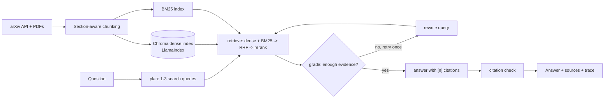

# ScholarAgent: agentic RAG over arXiv papers, with measured results

An assistant that answers research questions over a corpus of arXiv papers. It **plans** its search, **checks its own
retrieval** and retries when the evidence is weak, **cites** its sources, and ships with an **evaluation harness**
that measures every design choice (hybrid search, reranking, a fine-tuned embedder).



## Stack
Python | LlamaIndex + Chroma (dense) | rank-bm25 + RRF (sparse/fusion) | sentence-transformers cross-encoder (rerank) |
LangGraph (agent) | LangChain chat models (Gemini / Groq / Ollama) | LangSmith (tracing, experiments) |
PyTorch (embedder fine-tuning) | MCP (FastMCP) | FastAPI | Streamlit | Docker | GitHub Actions

## Project layout
```
scholaragent/
  ingest.py        arXiv -> PDFs -> section-aware chunks (data/chunks.jsonl)
  index.py         build/load the Chroma index (one collection per embedding model)
  retrieval.py     vector | bm25 | hybrid (+ cross-encoder rerank)
  tools.py         search_papers, get_paper, get_paper_evidence, compare_papers (shared by API/agent/MCP)
  agent.py         LangGraph graph: plan -> retrieve -> grade -> rewrite? -> answer -> citation check
  llm.py           provider-agnostic LLM + JSON helpers     synth.py  synthetic question generation
  api.py           FastAPI                                  mcp_server.py  MCP server
evaluation/        make_eval_set.py | run_eval.py | langsmith_eval.py
training/          make_pairs.py | finetune_embedder.py     (plain PyTorch loop)
app.py             Streamlit UI        tests/   Dockerfile   .github/workflows/ci.yml
```

## Setup
```bash
python -m venv .venv && source .venv/bin/activate        # Windows: .venv\Scripts\activate
pip install -r requirements.txt
cp .env.example .env                                      # add GOOGLE_API_KEY (or GROQ_API_KEY) and LANGSMITH_API_KEY
pytest -q                                                 # quick sanity check of the pure-Python parts
```

## Run it (in this order)
```bash
# 1. Build the corpus (pick ONE narrow topic; 300 papers is plenty). Takes a while: arXiv wants 3s between downloads.
python -m scholaragent.ingest --query 'abs:"LLM agents" AND (cat:cs.CL OR cat:cs.AI)' --max 300

# 2. Build the dense index
python -m scholaragent.index

# 3. Try it
streamlit run app.py                                      # chat UI
uvicorn scholaragent.api:app --reload                     # API docs at http://localhost:8000/docs
```

## Experiments (this is what makes the project stand out)
```bash
# A. Evaluation set from HELD-OUT papers. Then open data/eval_set.jsonl and delete/fix bad questions.
python -m evaluation.make_eval_set --n 100

# B. Retrieval ablation: vector vs bm25 vs hybrid vs hybrid+rerank (no LLM calls needed)
python -m evaluation.run_eval --label baseline --answers 30      # --answers also runs the agent + LLM judge

# C. Fine-tune the embedder on TRAIN-split papers only (no leakage into the eval set), then re-evaluate
python -m training.make_pairs --n 1000
python -m training.finetune_embedder --epochs 2 --out models/bge-small-scholar      # use a free GPU if you can
EMBED_MODEL=models/bge-small-scholar python -m scholaragent.index                   # new collection, automatic
EMBED_MODEL=models/bge-small-scholar python -m evaluation.run_eval --label finetuned

# D. (optional) the same eval as a tracked LangSmith experiment
python -m evaluation.langsmith_eval
```
Paste the tables from `evaluation/results/*.md` below. Keep your **real** numbers and write honestly about what did
not help; a negative result explained well reads better than a suspiciously perfect one.

| setup | chunk_hit@5 | paper_hit@5 | chunk_mrr@5 |
|---|---|---|---|
| vector | | | |
| bm25 | | | |
| hybrid | | | |
| hybrid + rerank | | | |
| hybrid + rerank, fine-tuned embedder | | | |

## MCP server
Exposes `search_papers`, `get_paper`, `get_paper_evidence`, `compare_papers` to any MCP client. Example Claude Desktop
config (`claude_desktop_config.json`); use absolute paths:
```json
{ "mcpServers": { "scholaragent": {
    "command": "/abs/path/to/.venv/bin/python",
    "args": ["-m", "scholaragent.mcp_server"],
    "cwd": "/abs/path/to/scholaragent" } } }
```
A stdio MCP server must never `print()` to stdout; this code logs to stderr only. For a quick manual test:
`npx @modelcontextprotocol/inspector python -m scholaragent.mcp_server`.

## Docker / deploy
```bash
docker build -t scholaragent .
docker run --env-file .env -v "$(pwd)/data:/app/data" -p 8000:8000 scholaragent
docker run --env-file .env -v "$(pwd)/data:/app/data" -p 8501:8501 scholaragent \
  streamlit run app.py --server.port 8501 --server.address 0.0.0.0
```
Build the index locally first and ship `data/` (or mount it). For a free public demo, Hugging Face Spaces (Streamlit
or Docker SDK) works; keep the corpus small and store API keys as Space secrets.

## Design decisions worth explaining in interviews
- **Section-aware chunking** with title + section prefixed to each chunk: better retrieval and better citations.
- **Hybrid search + RRF**: dense retrieval misses exact terms (model names, acronyms), BM25 misses paraphrases.
- **One rerank pass against the original question**, so rewritten sub-queries can't drift from what was asked.
- **Grade-then-retry** loop, capped (`MAX_ATTEMPTS`), instead of trusting the first retrieval.
- **Citation check is programmatic**: invalid `[n]` markers are removed and ungrounded answers are flagged.
- **Paper-level train/test split** (`hash_split`): the fine-tuned embedder never sees evaluation papers.
- **Collection per embedder**: baseline and fine-tuned indexes can't be mixed by accident.

